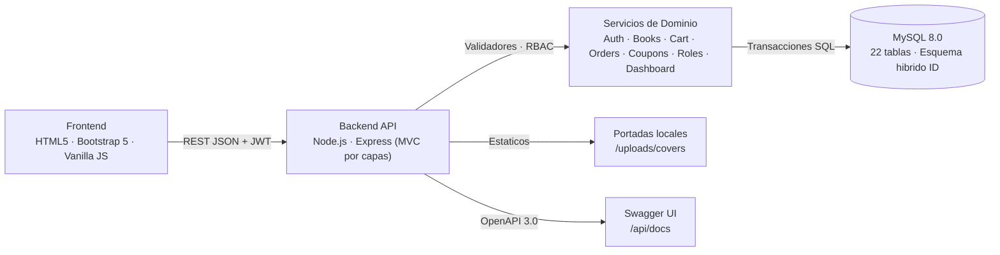

# Librería Virtual Danzara

Plataforma web integral de comercio electrónico, alquiler, facturación y lectura digital protegida para libros físicos y digitales, desarrollada como proyecto formativo del programa **Tecnólogo en Análisis y Desarrollo de Software (ADSO) – SENA**.

---

## Características principales

### Tienda y experiencia del cliente
- **Catálogo interactivo:** búsqueda en vivo con *debounce*, *pills* horizontales de categorías, filtros combinados por categoría y formato, ordenamiento (`recientes`, `precio`, `calificación`, `título`), paginación real y *skeletons* de carga.
- **Lista de Favoritos y Perfil:** botón de favoritos persistido en MySQL, vista **Mis Favoritos** y modal **Mi Perfil** para actualizar datos personales y contraseña.
- **Carrito y Pasarela de Pagos simulada:** soporte para compra y alquiler en un mismo carrito, validación de **cupones de descuento** (`DANZARA10` de ejemplo) y carrusel de métodos de pago (**Tarjeta** con enmascaramiento, **PSE**, **Transferencia** y **Efectivo**).
- **Facturación y trazabilidad:** generación automática de factura comercial secuencial (`FV-XXXX`) con nota de exención de IVA (Art. 478 E.T.) lista para imprimir/PDF, y **línea de tiempo visual** con el historial de estados de cada pedido.
- **e-Reader protegido:** visor en pantalla para libros comprados o alquilados vigentes con bloqueo de clic derecho, copia/selección, atajos de captura/impresión/DevTools, desenfoque al perder el foco, marca de agua dinámica, modos **Día / Sepia / Noche**, ajuste de tamaño de fuente (`A-` / `A+`), navegación por capítulos y guardado automático del progreso de lectura.

### Panel Administrativo y Seguridad
- **Dashboard ejecutivo:** barra lateral colapsable agrupada por módulos, tarjetas KPI, gráficas con Chart.js, **campana de alertas operativas** (stock bajo y alquileres vencidos) y exportación de reportes CSV (ventas, inventario y auditoría).
- **Control de acceso RBAC granular:** roles de sistema y personalizados, permisos por módulo y sobreescritura individual de permisos por usuario (`HEREDADO` / `CONCEDIDO` / `REVOCADO`).
- **Gestión operativa completa:** catálogo con carga local de portadas (JPG/PNG/WEBP) o URL externa, parametrización protegida contra integridad referencial (categorías, autores, editoriales, formatos), gestión de pedidos, **módulo de alquileres y devoluciones con cálculo automático de mora**, gestión de **cupones**, historial de inventario y bitácora de auditoría.
- **Seguridad:** contraseñas con `bcryptjs`, autenticación JWT, verificación anti-bot (CAPTCHA matemático firmado), recuperación de contraseña con tokens temporales SHA-256 en `tokens_sesion`, *rate limiting*, cabeceras `helmet` y validación de entradas por middleware.

---

## Arquitectura del sistema



### Modelo de datos (MySQL 8.0 – 22 tablas)
Se implementa una estrategia híbrida de identificadores:
- **Tablas maestras y de configuración (`INT AUTO_INCREMENT`):** `roles`, `permisos`, `rol_permisos`, `usuario_permisos`, `categorias`, `autores`, `editoriales`, `formatos`, `cupones`.
- **Entidades transaccionales y núcleo (`UUID CHAR(36)`):** `usuarios`, `tokens_sesion`, `libros`, `resenas`, `carrito_items`, `pedidos`, `detalle_pedidos`, `prestamos_alquileres`, `pagos`, `facturas`, `historial_estados_pedido`, `movimientos_inventario`, `auditoria_acciones`.
- **Relaciones compuestas de usuario-libro:** `favoritos` y `progreso_lectura`.

---

## Estructura del proyecto

```text
VIRTUAL_PUERTAS_DEL_SABER/
├── backend/
│   ├── database/
│   │   └── init.sql                 # Esquema completo MySQL, vistas y datos semilla
│   ├── src/
│   │   ├── config/                  # Conexion BD, logger Winston y especificacion OpenAPI
│   │   ├── controllers/             # Controladores HTTP por modulo
│   │   ├── middlewares/             # JWT/RBAC, validadores, rate limiter y errores
│   │   ├── routes/                  # Enrutadores REST
│   │   ├── services/                # Logica de negocio y transacciones
│   │   ├── utils/                   # Clases de error
│   │   ├── app.js                   # Aplicacion Express + Swagger + estaticos
│   │   └── server.js                # Arranque del servidor
│   ├── tests/
│   │   └── api.test.js              # Suite de pruebas unitarias (node:test)
│   ├── Dockerfile
│   └── package.json
├── frontend/
│   ├── assets/images/               # Emblema cultural Danzara
│   ├── css/styles.css               # Sistema de diseno corporativo
│   ├── js/                          # api.js, app.js, admin.js, factura.js, visor.js
│   ├── index.html                   # Tienda publica y cuenta de cliente
│   ├── admin.html                   # Panel administrativo con Sidebar
│   ├── factura.html                 # Factura imprimible FV-XXXX
│   └── visor.html                   # Lector e-Reader protegido
├── .devcontainer/                   # Configuracion para GitHub Codespaces
├── docker-compose.yml               # Orquestacion MySQL 8.0 + Backend Node.js
└── README.md
```

---

## Instalación y ejecución

### Opción 1: Docker Compose (recomendada)

1. Crea un archivo `.env` en la raíz (opcional; `docker-compose.yml` trae valores por defecto para desarrollo):
   ```env
   PORT=3000
   DB_NAME=puertas_del_saber_db
   DB_USER=puertas_del_saber_user
   DB_PASSWORD=puertas_del_saber_pass
   DB_ROOT_PASSWORD=root_master_pass
   JWT_SECRET=tu_clave_secreta_super_segura
   ```
2. Levanta los servicios:
   ```bash
   docker compose up -d --build
   ```
3. Abre la plataforma en tu navegador:
   - **Tienda:** http://localhost:3000/index.html
   - **Panel Admin:** http://localhost:3000/admin.html
   - **Documentación API (Swagger UI):** http://localhost:3000/api/docs
   - **Salud del sistema:** http://localhost:3000/api/health

> Si sirves el frontend mediante **XAMPP** (`http://localhost/VIRTUAL_PUERTAS_DEL_SABER/frontend/index.html`), el cliente detecta automáticamente el puerto y consume la API en `http://localhost:3000/api`.

### Opción 2: GitHub Codespaces
El repositorio incluye `.devcontainer/devcontainer.json`. Al abrir un Codespace, se levantan los contenedores automáticamente y el puerto `3000` expone tanto la API como el frontend.

---

## Pruebas automatizadas

Para ejecutar la suite de pruebas unitarias dentro del contenedor backend:

```bash
docker exec VIRTUAL_PUERTAS_DEL_SABER_backend npm test
```

Incluye verificación de permisos RBAC, validación y enmascaramiento de pagos (Tarjeta y PSE), generación de CAPTCHA JWT, motor de cupones, middlewares de validación y especificación OpenAPI 3.0.

---

## Equipo de desarrollo

- **Miguel Rendón** – Líder / Programador
- **Gillson Martínez** – Programador (Base de datos y Backend)
- **Viviana Puerta** – Programadora (Interfaz)

## Contacto

- miguelrendonrg@gmail.com

---

Proyecto académico – SENA ADSO · Horizonte Digital
